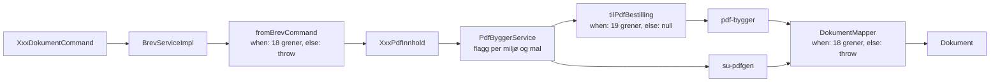
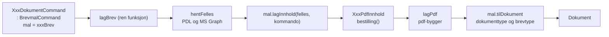

# Prototype: funksjonell brevarkitektur

**Status:** prototype på branchen `brev/test-funksjonell-orientering-202611261718`. Den merges ikke og når
ikke prod før teamet har konsensus. Avviket fra dagens mønster er ført i
`.github/ai-historikk/avvik.jsonl` (id `brevmal-avvist-soknad-vedtak`, status `prototype`).

## Kort fortalt

Et brev går fra én kommando til ett dokument gjennom én ren funksjon, `lagBrev`. Kommandoen peker selv
på malen sin, innholdet lager sin egen PDF-bestilling, og pdf-bygger er eneste PDF-generator. Alle de
sentrale `when`-blokkene som koblet kommandoer, innhold og maler sammen, er borte. En mal som mangler
noe, kompilerer ikke.

## Flyten før



En mal var spredt over seks steder: kommandoklassen, en gren i `fromBrevCommand`, innholdsklassen, et
objekt i `DokumentMal` med `lagBestilling`, en gren i `tilPdfBestilling` og en gren i `DokumentMapper`.
En glemt gren feilet først i drift.

## Flyten nå



`lagBrev` får effektene som parametre (`hentFelles` og `lagPdf`). Resten av kjeden er ren og testes
uten mocks (`LagBrevTest`).

## Hva som er forenklet

| | Før | Nå |
| --- | --- | --- |
| Sentrale `when` over kommando- eller innholdstype | 3 blokker, 55 grener, `else -> throw` og `else -> null` | Ingen |
| Kobling mellom kommando og mal | `fromBrevCommand`, `DokumentMapper` og `tilPdfBestilling` i tre filer og to moduler | `override val mal` i kommandoen |
| Hvor én mal bor | 6 steder | Kommandoen, Brevmal-verdien ved mappingen og innholdsklassen. Enkle maler, som avvist søknad, bor i én fil |
| Glemt mal eller gren | Feiler i drift | Kompilerer ikke (`bestilling()` og `lagInnhold()` er abstrakte), og kompletthetstesten blir rød |
| PDF-generatorer | To, med flagg per miljø og per mal, og dobbel generering i dev | Én: pdf-bygger |
| `PdfByggerService` | 139 linjer | 35 linjer |
| `DokumentMal` | 288 linjer med `navn`, flagg og 18 `lagBestilling` | 122 linjer, bare `tittel` |
| `MapDokumentCommandToPdfInnhold` | 185 linjer | 74 linjer: `hentFelles` og `tilPdfInnhold` |
| Slettet kode | | `GenererDokumentCommand`, `DokumentMapper`, `PdfClient`, `KontrollnotatPdfgenData`, `PdfGeneratorStub` |
| Konfigurasjon | `PDFGEN_URL`, `PDFGEN_LOCAL`, to config-felt, outbound til su-pdfgen i tre nais-filer | Borte |
| Tester | Ordsammenligning mot 18 PDF-er fra su-pdfgen og ordlister i testdataene | Egenskapstester og rendering i pdf-bygger |
| `PdfByggerServiceTest` | 460 linjer | 69 linjer |

Samlet mot `master` (da dokumentet ble skrevet): 159 filer, +1 696 og −8 460 linjer. Produksjonskoden er
81 filer, +764 og −1 007. Testkoden er 65 filer, +902 og −7 399.

## Byggeklossene

Alle ligger i `dokument/domain/src/main/kotlin/dokument/domain/generer/Brevmal.kt`.

```kotlin
interface BrevmalCommand {
    val fødselsnummer: Fnr
    val saksnummer: Saksnummer
    val sakstype: Sakstype
    val saksbehandler: NavIdentBruker?
    val attestant: NavIdentBruker?
    val mal: Brevmal<*>
    fun lagInnhold(felles: Felles): PdfInnhold
}

class Brevmal<F>(
    val dokumenttype: Dokumenttype,
    val brevtype: Brevtype,
    val lagInnhold: (Felles, F) -> PdfInnhold,
)

fun lagBrev(
    command: BrevmalCommand,
    hentFelles: (BrevmalCommand) -> Either<KunneIkkeLageDokument, Felles>,
    lagPdf: (PdfInnhold) -> Either<KunneIkkeLageDokument, PdfA>,
    id: UUID,
    opprettet: Tidspunkt,
): Either<KunneIkkeLageDokument, Dokument.UtenMetadata> = either {
    val felles = hentFelles(command).bind()
    val innhold = command.lagInnhold(felles)
    val pdf = lagPdf(innhold).bind()
    command.mal.tilDokument(pdf, innhold, id, opprettet)
}
```

Et eksempel på kommando og mal (avvist klage):

```kotlin
data class Avvist(/* domenefelt */) : KlageDokumentCommand {
    override val mal: Brevmal<Avvist> get() = klageAvvistBrev
    override fun lagInnhold(felles: Felles): PdfInnhold = mal.lagInnhold(felles, this)
}

val klageAvvistBrev = Brevmal<KlageDokumentCommand.Avvist>(Dokumenttype.VEDTAK, Brevtype.VEDTAK) { felles, kommando ->
    kommando.fromBrevCommand(felles.personalia, felles.saksbehandlerNavn, felles.attestantNavn ?: "-")
}
```

## Slik lager du en ny mal

1. Innholdsklassen i `dokument/domain/.../bygger/maler/` med `override fun bestilling()`.
2. Tittelen i `DokumentMal`.
3. En kommando som implementerer `BrevmalCommand`.
4. En `Brevmal`-verdi med dokumenttype, brevtype og `lagInnhold`, i modulen som eier domenetypene.
5. Et eksempel i `MalEksempler.kt`. Ellers blir kompletthetstesten rød.

## Testene

- **`MalEgenskapTest`** kjører egenskapstester med `kotest-property` på markup-treet, uten Docker. Den
  varierer et realistisk eksempel per mal med lite, mye eller ingenting av valgfritt innhold. Egenskapene
  er E1–E8: lager bestilling, er deterministisk, har ingen tomme blokker eller ugyldige linjeskift, har
  rektangulære tabeller, lekker ikke `null` eller `toString()`, har saksinformasjon som samsvarer med
  personalia, viser saksbehandlers fritekst og kan serialiseres.
- **`MalRenderTest`** sender faste varianter til pdf-bygger i en testcontainer. E9 sjekker at PDF-en er
  gyldig, og E10 at friteksten kommer fram med alle tegn. Bildet er låst til en digest, og testklassene
  deler en lås, slik at det emulerte amd64-bildet ikke overbelastes.
- **`LagBrevTest`** og **`BrevmalTilDokumentTest`** tester kjeden og mappingen til dokumenttype uten mocks.

Egenskapstestene fant feil i `fritekst()`: blank fritekst ga tomme avsnitt, og tre linjeskift på rad ga
avsnitt som startet med linjeskift. Det er rettet.

## Bevisste valg

- **Kommandoen implementerer et interface (alternativ B).** Det andre alternativet var én generisk
  `BrevmalCommand<F>`-klasse (A). A ville krevd at typede signaturer i iverksettingen, `copy(dødsbo)` i
  klage og hendelsene i tilbakekreving ble skrevet om. B gir samme flyt og lar domenekoden som ikke
  handler om brev, stå urørt.
- **JSON-formen på innholdet er uendret.** Den sendes til dokarkiv som `originalJson` og leses av SQL
  (`personalia.dato` og `fritekst`).
- **`DokumentMal` er beholdt som titteloversikt.** Den forseglede oversikten driver kompletthetstesten og
  samler titlene som brukes i Gosys.
- **Effektene ligger bare i `hentFelles` og `lagPdf`.** `Felles.attestantNavn` er `null` når attestant
  mangler, og hver mal bestemmer om den viser «-». `Felles.idag` erstatter `clock` i tilbakekreving.
- **Lesetimeouten mot pdf-bygger er 60 sekunder.** Klienten var satt opp med 60, men brukte Fuel sin
  standard på 15 for svaret.

## Utenfor prototypen og åpne punkter

- **Reguleringsmalen er en kladd** overført fra su-pdfgen. Den må godkjennes av faget. Den viser også
  satsoversikten, noe su-pdfgen-versjonen ikke gjorde.
- **`sup` og su-pdfgen-appen er ikke endret.** De trengs fortsatt mot `master`.
- **Felt som bare fantes for su-pdfgen** (for eksempel `søkedato`, `harEktefelle` og datofeltene i
  tilbakekreving) er beholdt fordi de er en del av JSON-kontrakten. Om de skal fjernes, er en egen
  beslutning.
- **Brevmal som teamregel:** hvis teamet vil gå videre, skal mønsteret inn i
  `.github/instructions/kotlin.instructions.md` og `endringer.jsonl`, og avviket avsluttes.
